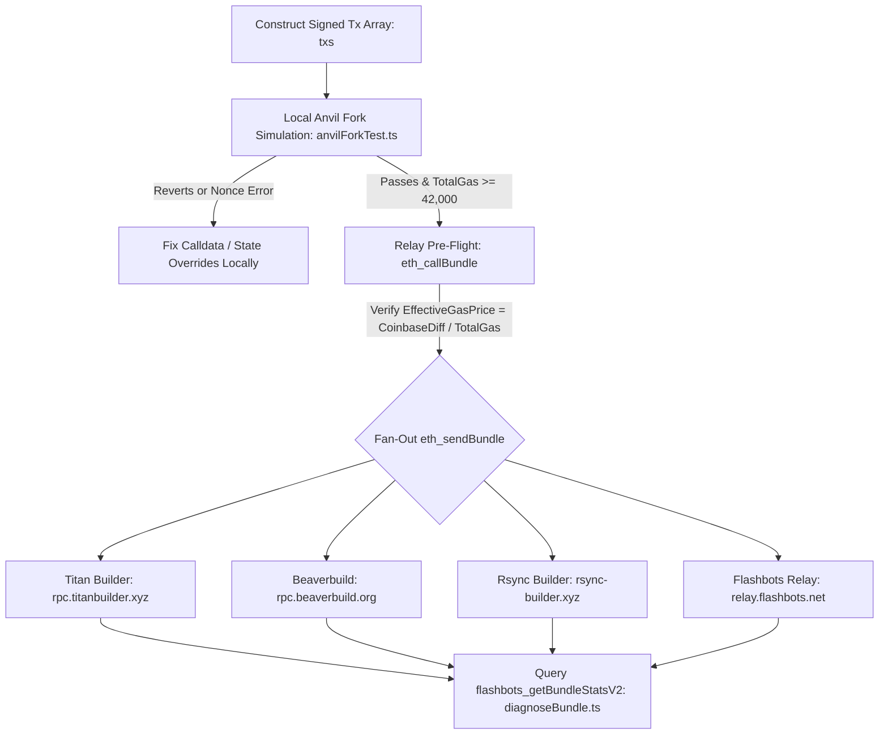

# Flashbots Bundle Simulator & Anvil Mainnet Fork Testing Toolkit (`eth_callBundle` & `eth_sendBundle`)

**TL;DR:** A **Flashbots bundle** is an ordered array of signed raw Ethereum transactions submitted privately to block builders via `eth_sendBundle` that executes atomically in a target block (`blockNumber`) or drops completely without costing gas. When a **Flashbots bundle is not included** on-chain despite succeeding locally, the failure almost always traces back to one of five root causes: (1) sending only to `relay.flashbots.net` (~8% block share) instead of fanning out to **Titan Builder**, **Beaverbuild**, and **Rsync Builder** (>85% combined share); (2) a low **Effective Bundle Gas Price** ($\Delta\text{Coinbase} / \sum\text{GasUsed}$) diluted by a gas-heavy target transaction; (3) an unhandled revert inside the bundle without `revertingTxHashes`; (4) total bundle gas falling below the `42,000` gas relay floor; or (5) a nonce gap / state change between simulation (`eth_callBundle`) and slot sealing. This open-source TypeScript (`viem`) + Foundry Anvil toolkit is maintained by **[MEV DAO](https://mevdao.org)** alongside our engineering guides on **[Flashbots Bundles Explained: How to Send `eth_sendBundle` and Why Yours Isn't Landing](https://mevdao.org/blog/flashbots-bundles-explained-how-to-send-eth-sendbundle-and-why-yours-isn-t-landi)** and **[How to Test an MEV Bot on a Mainnet Fork with Anvil](https://mevdao.org/blog/how-to-test-an-mev-bot-on-a-mainnet-fork-with-anvil)**.

[](./LICENSE)
[](https://mevdao.org)
[](https://mevdao.org/blog/how-to-test-an-mev-bot-on-a-mainnet-fork-with-anvil)
[](https://www.typescriptlang.org/)

---

## Core Engineering Guides & Production Links

- **Complete `eth_sendBundle` Troubleshooting Guide:** **[Flashbots Bundles Explained: How to Send `eth_sendBundle` and Why Yours Isn't Landing](https://mevdao.org/blog/flashbots-bundles-explained-how-to-send-eth-sendbundle-and-why-yours-isn-t-landi)**
- **Anvil Mainnet Fork Testing Tutorial:** **[How to Test an MEV Bot on a Mainnet Fork with Anvil](https://mevdao.org/blog/how-to-test-an-mev-bot-on-a-mainnet-fork-with-anvil)**
- **Private RPC & OFA Comparison:** **[Flashbots Protect vs MEV Blocker: Which Private RPC Should You Use?](https://mevdao.org/blog/flashbots-protect-vs-mev-blocker-which-private-rpc-should-you-use)**
- **Official Infrastructure Portal:** **[MEV DAO (mevdao.org)](https://mevdao.org)**

---

## Why Your Flashbots Bundle Is Not Included (The 7 Root Causes)

Searchers and whitehat engineers frequently ask why `eth_sendBundle` returns a valid `bundleHash` (`{"jsonrpc":"2.0","id":1,"result":{"bundleHash":"0x..."}}`) and `eth_callBundle` succeeds, yet the bundle never lands in the target block.

Crucially, **receiving a `bundleHash` from `eth_sendBundle` only confirms syntactic receipt by the relay HTTP ingress**—it does *not* mean the bundle passed builder simulation or won the block auction!



### Diagnostic Matrix: `flashbots_getBundleStatsV2` Flags Explained

When you run `npm run diagnose -- <bundleHash> <blockNumber>` (`src/diagnoseBundle.ts`), the relay returns boolean lifecycle flags that pinpoint the exact stage where your bundle was dropped:

| `isSimulated` | `isSentToMiners` | `isHighPriority` | Root Cause & Exact Engineering Fix |
| :--- | :--- | :--- | :--- |
| `false` | `false` | `any` | **Never Simulated:** Total bundle gas was `< 42,000`, one of the txs had a stale nonce, or the bundle arrived after the slot sealing cutoff. |
| `true` | `false` | `false` | **Outbid on Effective Gas Price:** Your bundle simulated without reverting, but $\Delta\text{Coinbase} / \text{TotalGas}$ was lower than competing transactions in the block. |
| `true` | `true` | `true` | **Builder Lost the Slot:** Flashbots simulated and included your bundle in its candidate block, but **Titan**, **Beaverbuild**, or **Rsync** won the MEV-Boost slot auction! You must fan out `eth_sendBundle` to all major builders. |

---

## The Math Behind Builder Inclusion: Effective Bundle Gas Price

Block builders do not rank bundles by raw ETH bribe alone; they rank bundles by **builder profit per unit of gas consumed** (Effective Bundle Gas Price) so they can pack the `30,000,000` (or `36,000,000` post-Pectra) block gas limit as profitably as possible:

$$\text{Effective Bundle Gas Price} = \frac{\text{ethSentToCoinbase} + \sum_{i=1}^{k} \left(\text{effectiveGasPrice}_i - \text{baseFeePerGas}\right) \times \text{gasUsed}_i}{\sum_{i=1}^{k} \text{gasUsed}_i}$$

### The "Victim Gas Dilution" Trap in Backrun & Sniper Bundles

Suppose you are backrunning a pending Uniswap router swap (`Tx_0`) with your own arbitrage or sniper transaction (`Tx_1`):
- `Tx_0` (the public mempool transaction you are backrunning) consumes `250,000` gas and pays only a `1 gwei` priority fee.
- `Tx_1` (your backrun transaction) consumes `150,000` gas and pays `0.02 ETH` (`20,000,000,000,000,000 wei`) directly to `block.coinbase`.
- If `Tx_1` were evaluated alone, its effective gas price would be $\frac{0.02\text{ ETH}}{150,000} = 133.33\text{ gwei}$.
- **However**, because `Tx_0` is part of your bundle `[Tx_0, Tx_1]`, the builder divides your `0.02 ETH` bribe by the **combined gas** ($250,000 + 150,000 = 400,000$ gas):
  $$\text{Actual Effective Bundle Gas Price} = \frac{0.02\text{ ETH} + 0.00025\text{ ETH}}{400,000\text{ gas}} = 50.625\text{ gwei}$$
- Our `analyzeCallBundleResult()` function in `src/simulateBundle.ts` computes this exact ratio from the `eth_callBundle` response and warns you before you broadcast.

---

## Comparison: `eth_sendBundle` vs. Flashbots Protect RPC vs. MEV Blocker

Not every transaction requires a raw multi-transaction `eth_sendBundle` array. If you are submitting a single transaction that simply needs front-running protection (or backrun rebates), compare the three private execution paths below (and read **[Flashbots Protect vs MEV Blocker: Which Private RPC Should You Use?](https://mevdao.org/blog/flashbots-protect-vs-mev-blocker-which-private-rpc-should-you-use)**):

| Feature / Capability | Direct `eth_sendBundle` (Multi-Builder) | Flashbots Protect (`rpc.flashbots.net`) | MEV Blocker (`rpc.mevblocker.io`) |
| :--- | :--- | :--- | :--- |
| **Multi-Transaction Atomic Arrays (`[Tx1, Tx2]`)** | **Yes (Strict atomic ordering)** | No (Single `eth_sendRawTransaction`) | No (Single `eth_sendRawTransaction`) |
| **42,000 Minimum Gas Floor** | **Yes (Enforced on raw bundles)** | No (Single 21k ETH transfers allowed) | No |
| **Target Exact Block (`blockNumber`)** | **Yes (Single-block precision)** | No (Retries automatically for ~25 blocks) | No (Retries automatically) |
| **Cost on Reverted Transaction** | **$0.00 (Dropped before inclusion)** | $0.00 (If revert protection enabled) | $0.00 (Unless `?norevert` disabled) |
| **Best Use Case** | **Sniping, Arbitrage, Whitehat Sweeper Rescues** | Private wallet transfers & simple swaps | Retail DEX swaps seeking OFA rebates |

---

## Deterministic Mainnet Fork Testing with Foundry Anvil (`src/anvilForkTest.ts`)

Calling `eth_callBundle` over HTTPS against `relay.flashbots.net` adds `80ms–250ms` of network round-trip latency and is rate-limited if your `FLASHBOTS_AUTH_KEY` does not have high searcher reputation.

As explained in **[How to Test an MEV Bot on a Mainnet Fork with Anvil](https://mevdao.org/blog/how-to-test-an-mev-bot-on-a-mainnet-fork-with-anvil)**, you can simulate any multi-transaction bundle locally in **under 15 milliseconds** with 100% EVM parity using Foundry's `anvil`:

### How `simulateBundleOnAnvilFork()` Replicates a Block Builder Locally

1. **Pin State to Any Historical or Live Block:**
   ```bash
   anvil --fork-url https://eth-mainnet.g.alchemy.com/v2/YOUR_KEY --fork-block-number 21000000
   ```
2. **Snapshot State (`evm_snapshot`):** Takes an instant copy-on-write memory snapshot so you can test thousands of bundle variations against the exact same block without restarting Anvil.
3. **Disable Automining (`anvil_setAutoMine(false)`):** By default, Anvil mines a new block on every `eth_sendRawTransaction`. Turning automine off puts Anvil into **builder pending pool mode**, queueing `[Tx_0, Tx_1, Tx_2]` in exact submission order inside the same pending block.
4. **Mine Single Block (`evm_mine`) & Measure `block.coinbase` Delta:** `src/anvilForkTest.ts` records `getBalance(block.miner)` before and after mining the single block, giving you the exact `coinbaseDiff` (both priority fees and explicit `block.coinbase.call{value: bribe}("")` transfers) and per-transaction gas receipts.
5. **Instant Revert (`evm_revert`):** Restores the fork to its clean pre-bundle state in `< 2ms`.

---

## Installation & Usage

### Prerequisites
- **Node.js** `>= 20.x`
- **Foundry (`anvil`)** (`curl -L https://foundry.paradigm.xyz | bash && foundryup`)

### 1. Clone & Install

```bash
git clone https://github.com/mevdao-org/flashbots-bundle-simulator-anvil.git
cd flashbots-bundle-simulator-anvil
npm install
cp .env.example .env
```

### 2. Simulate & Analyze a Flashbots Bundle (`npm run simulate`)

```bash
npm run typecheck
npm run simulate
```

### 3. Diagnose Why a Specific Bundle Did Not Land (`npm run diagnose`)

Pass any `bundleHash` and target `blockNumber` (or configure them in `.env`) to inspect `flashbots_getBundleStatsV2` and `flashbots_getUserStatsV2`:

```bash
npm run diagnose -- 0x3b91a8c2e41d9081b771984d2a1b4a8c9012f8e3d4c5b6a79081726354453627 21000000
```

### 4. Run Local Anvil Mainnet Fork Bundle Tests (`npm run anvil-test`)

```bash
# Terminal 1: Start Anvil forked from Ethereum Mainnet
anvil --fork-url $ETH_HTTP_RPC_URL --port 8545

# Terminal 2: Run the Anvil bundle simulator
npm run anvil-test
```

---

## Complete Multi-Builder JSON-RPC Reference (2026)

To maximize inclusion probability, send identical `eth_sendBundle` payloads to all active Ethereum block builders simultaneously:

| Builder | RPC Endpoint | Supports `eth_sendBundle` | Supports `eth_callBundle` | Supports `revertingTxHashes` |
| :--- | :--- | :--- | :--- | :--- |
| **Titan Builder** | `https://rpc.titanbuilder.xyz` | Yes | No (Use Anvil / Flashbots) | Yes |
| **Beaverbuild** | `https://rpc.beaverbuild.org` | Yes | No | Yes |
| **Rsync Builder** | `https://rsync-builder.xyz` | Yes | No | Yes |
| **Flashbots** | `https://relay.flashbots.net` | Yes | **Yes** | Yes |

### Correct EIP-191 `X-Flashbots-Signature` Header Implementation

One of the most frequent bugs when calling `eth_callBundle` or `eth_sendBundle` directly from TypeScript or Python is hashing the JSON body incorrectly before signing. You must sign the **UTF-8 hex string of the `keccak256` hash** of the raw request body using EIP-191 (`\x19Ethereum Signed Message:\n660x...`):

```typescript
import { keccak256, toBytes, type Hex } from "viem";
import { privateKeyToAccount } from "viem/accounts";

export async function createFlashbotsSignatureHeader(rawJsonBody: string, authPrivateKey: Hex): Promise<string> {
  const signer = privateKeyToAccount(authPrivateKey);
  const bodyHashHex = keccak256(toBytes(rawJsonBody)); // e.g. "0x8a3f..." (66 chars)
  const signature = await signer.signMessage({ message: bodyHashHex });
  return `${signer.address}:${signature}`;
}
```

---

## Frequently Asked Questions (FAQ)

### 1. Why did `eth_sendBundle` return a `bundleHash` if my bundle was never included on-chain?
`eth_sendBundle` is an asynchronous ingestion endpoint. It validates only your JSON schema and `X-Flashbots-Signature` header before returning the deterministic `bundleHash` (`keccak256` of the concatenated transaction hashes). Actual simulation, gas ranking, and block packing happen asynchronously inside the block builder over the next few hundred milliseconds.

### 2. Why do Flashbots bundles require at least 42,000 total gas?
To prevent spam and DoS attacks on builder simulation workers from single 21,000-gas ETH transfers, `relay.flashbots.net` enforces a `42,000` gas floor on `eth_sendBundle`. A two-transaction bundle (e.g., two `21,000` gas transfers or a funding tx + ERC-20 transfer) naturally exceeds `42,000` gas. If you only need to send a single transaction privately, use Flashbots Protect (`https://rpc.flashbots.net`) or MEV Blocker (`https://rpc.mevblocker.io`).

### 3. What happens if one transaction inside my Flashbots bundle reverts?
By default, if **any** transaction in the `txs` array reverts during block construction, the builder rejects the **entire bundle** so you never pay gas for a broken atomic strategy. If a specific transaction in your bundle is allowed to fail (for example, an optional cleanup call), add its hash to the `revertingTxHashes: ["0x..."]` array in `eth_sendBundle`.

### 4. Why should I target 3 consecutive blocks (`blockNumber + 1`, `+ 2`, `+ 3`) when sending a rescue or non-block-0 bundle?
Ethereum slot times are 12 seconds, and network latency or builder slot handoffs mean a bundle sent 2 seconds before the end of Slot $N$ may arrive too late for Block $N+1$. Submitting signed `eth_sendBundle` requests targeting `blockNumber + 1`, `blockNumber + 2`, and `blockNumber + 3` ensures seamless rollover if your bundle misses the immediate slot cutoff. Once the transactions are mined in Block $N+1$, the bundles for $N+2$ and $N+3$ automatically become invalid due to used nonces and are dropped for free.

### 5. How do I simulate a Flashbots bundle against a pending mempool transaction?
Fetch the full signed RLP hex of the pending transaction using `eth_getRawTransactionByHash` (supported by Alchemy, QuickNode, or local Geth/Reth nodes), prepend it as `txs[0]` ahead of your signed backrun transaction `txs[1]`, and pass `[txs[0], txs[1]]` to either `eth_callBundle` or `simulateBundleOnAnvilFork()` in `src/anvilForkTest.ts`.

### 6. Does `FLASHBOTS_AUTH_KEY` need to hold ETH or match my trading wallet?
No. `FLASHBOTS_AUTH_KEY` is purely an off-chain identity key used to sign the `X-Flashbots-Signature` HTTP header so relays can track searcher reputation (`flashbots_getUserStatsV2`). It never signs on-chain transactions and requires `0 ETH`. However, keeping a consistent `FLASHBOTS_AUTH_KEY` that submits valid, high-profit bundles builds relay reputation and grants access to the high-priority simulation queue during network congestion.

---

## Further Reading & MEV Infrastructure

- **[MEV DAO Official Portal (mevdao.org)](https://mevdao.org)**
- **[Flashbots Bundles Explained: How to Send `eth_sendBundle` and Why Yours Isn't Landing](https://mevdao.org/blog/flashbots-bundles-explained-how-to-send-eth-sendbundle-and-why-yours-isn-t-landi)**
- **[How to Test an MEV Bot on a Mainnet Fork with Anvil](https://mevdao.org/blog/how-to-test-an-mev-bot-on-a-mainnet-fork-with-anvil)**
- **[Flashbots Protect vs MEV Blocker: Which Private RPC Should You Use?](https://mevdao.org/blog/flashbots-protect-vs-mev-blocker-which-private-rpc-should-you-use)**
- **[Ethereum Sniper Bot: Flashbots Same-Block Sniping on Uniswap](https://mevdao.org/blog/ethereum-sniper-bot-flashbots-same-block-sniping-on-uniswap)**

## License

Released under the [MIT License](./LICENSE) by **MEV DAO** (`research@mevdao.org`).
